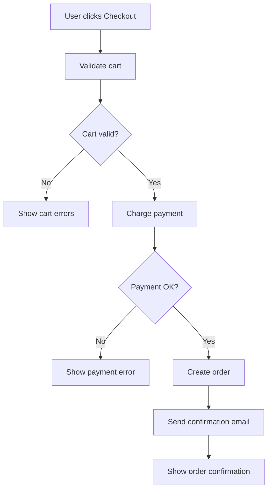
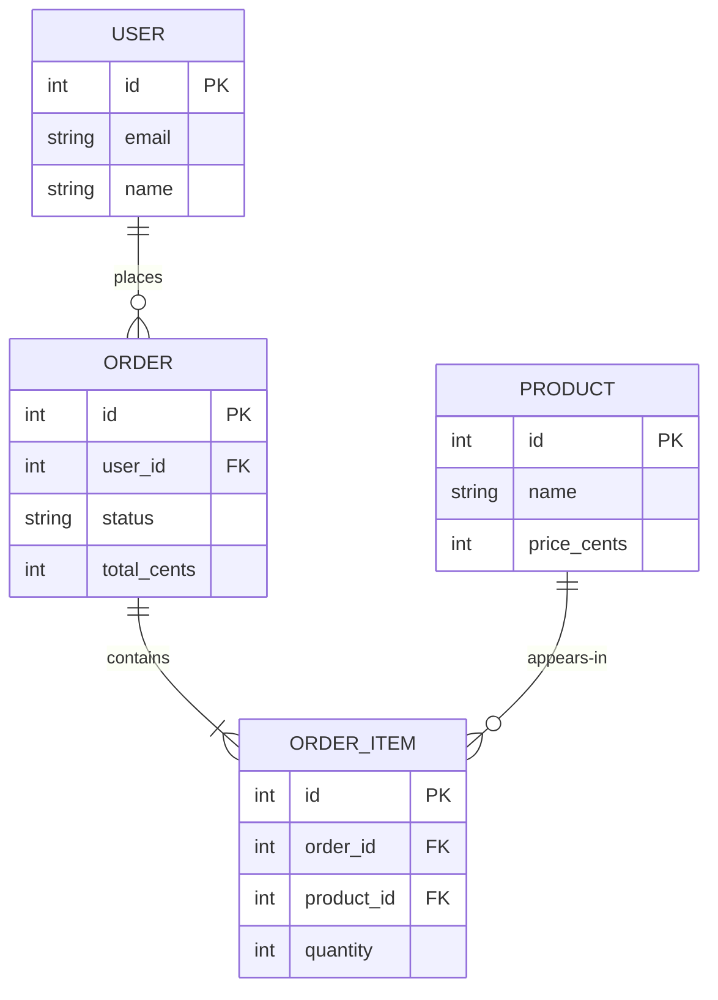

# Diagram Design

Design diagrams that explain something in one glance. A good diagram answers
one question: how does this work, what talks to what, or what happens next.
Pick the diagram type from the question, keep the number of boxes small, and
label every arrow so the reader never has to guess what a line means.

## Choosing the Diagram Type

| Question | Diagram type | Mermaid type |
|----------|--------------|--------------|
| What steps happen, in what order, with which decisions? | Flowchart | `flowchart TD` |
| Who calls whom, and in what order? | Sequence diagram | `sequenceDiagram` |
| What entities exist and how are they related? | ER diagram | `erDiagram` |
| What states can something be in, and what moves it? | State diagram | `stateDiagram-v2` |
| What are the parts of a system and how do they connect? | Architecture / component diagram | `flowchart LR` with subgraphs |
| How does data move through a pipeline? | Data-flow diagram | `flowchart LR` |
| What does the user see and click? | Wireframe flow / user journey | `flowchart TD` with screens as nodes |

Do not use a flowchart for a conversation between services; that is a
sequence diagram. Do not use a sequence diagram for a database schema; that
is an ER diagram. If the question is "what is the structure", draw structure.
If the question is "what happens over time", draw a sequence.

## Workflow

1. Write the one-sentence question the diagram must answer, for example
   "How does a checkout request reach the payment gateway?"
2. List the actors, components, or entities involved. Stop at seven. If the
   list is longer, split the diagram into two: one overview, one detail.
3. List the steps or relationships in order. Number them before drawing so
   the diagram follows the list, not the other way around.
4. Pick the diagram type from the table above.
5. Draw the draft with short node labels: 2-5 words per node, verbs on
   arrows, for example `User -->|places order| Checkout`.
6. Check readability: no more than 12 nodes, no more than 15 arrows, no
   arrow crossing another arrow, no label smaller than the rest.
7. Add a title and a one-line caption under the diagram stating what the
   reader should take away.
8. Render the Mermaid code and look at the result. Fix overlaps by
   reordering nodes or splitting the diagram, not by shrinking the font.

## Labelling Rules

- Node labels name a thing or a step: `Checkout`, `Validate payment`,
  `Orders table`. Never label a node with a full sentence.
- Arrow labels name the action or the data: `POST /orders`,
  `returns 402`, `order_id`. An unlabeled arrow is a missing explanation.
- Decision diamonds hold a yes/no question only: `Payment OK?`. The two
  outgoing arrows are labelled `Yes` and `No`.
- Use the same wording as the codebase: if the code calls it `OrderService`,
  the diagram calls it `OrderService`, not `Order Handler`.
- Add a legend only when shapes mean different things, for example a
  cylinder for a database and a rectangle for a service. Otherwise skip it.

## Example 1: Flowchart — Order Checkout

Input: "Draw how checkout works, including the payment failure path."



Output: one flowchart with a single start, two decision points, and both
failure paths returning the user to a visible error instead of a dead end.

## Example 2: Sequence Diagram — Login With Refresh Token

Input: "Show the login flow between the browser, API, and auth service."

```mermaid
sequenceDiagram
    actor User
    participant Browser
    participant API
    participant Auth
    participant DB
    User->>Browser: Enter email + password
    Browser->>API: POST /login
    API->>Auth: Verify credentials
    Auth->>DB: Look up user by email
    DB-->>Auth: User record + password hash
    Auth-->>API: Access token + refresh token
    API-->>Browser: 200 + tokens
    Browser->>Browser: Store refresh token
    Note over Browser,API: Access token expires in 15 min;<br/>refresh token renews it silently
```

Output: a sequence diagram where every arrow is a real request, the return
arrows use `-->>`, and the note explains the token lifetime instead of
leaving it implied.

## Example 3: ER Diagram — Shop Orders

Input: "Draw the database for users, orders, and products."



Output: an ER diagram with primary and foreign keys marked, one line per
relationship, and no table carrying columns that belong to another table.

## Checklist

- One question answered per diagram; a second question gets a second diagram.
- At most 12 nodes and 15 arrows; more means the diagram needs splitting.
- Every arrow labelled with an action or data, every decision with Yes/No.
- Node labels are 2-5 words and match names used in the code or product.
- No arrow crosses another arrow; no text overlaps another box.
- Title plus one-line takeaway caption under the diagram.
- Mermaid code renders without errors before delivery.

## Pitfalls

- Too many boxes: a diagram with 30 nodes is a wall of text, not a diagram.
  Split it into an overview plus one detail diagram per subsystem.
- Tiny text: shrinking the font to fit more boxes hides the problem. Remove
  boxes instead; if a box is not needed to answer the question, delete it.
- Arrows crossing: crossed arrows force the reader to trace lines with a
  finger. Reorder the nodes, switch `TD` to `LR`, or split the flow.
- Unlabelled arrows: an arrow without a label says "something happens" and
  nothing else. Label it or remove it.
- Mixing levels: do not put a database table, a user action, and a line of
  code in the same diagram. One diagram, one level of detail.
- Decorative shapes and colours that carry no meaning: colour only to group
  related nodes, and say what the colour means.
- Long sentences inside nodes: move the explanation to the caption or to
  the text around the diagram, and keep nodes short.
