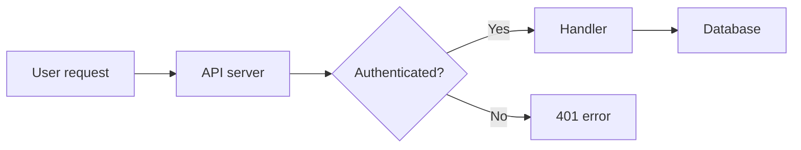

# Docs Writer

Write documentation a stranger can follow without asking the author a
question. Every claim in the docs must match the code as it is today, not
as it was planned or as it used to be.

## When to Use This Skill

- The user asks for a README, guide, tutorial, API reference, or changelog.
- A new project, feature, or API ships without documentation.
- Existing docs are outdated, confusing, or missing examples.
- The user asks "how do I use this" or "explain how this works".

## When Not to Use It

- The user wants code written, not explained.
- The feature being documented does not exist yet and its behaviour is
  still undecided; document what is built, not what is hoped for.

## Principles

1. **Reader first.** Write for someone who has never seen this project; define every term on first use.
2. **Example-led.** Show a working example before explaining theory; a reader who copies it should get a working result.
3. **One page, one job.** A README introduces; a guide teaches a task; a reference lists exact behaviour. Do not mix them.
4. **Honest limits.** Say what the software cannot do, what is untested, and what needs the user's own account or key.
5. **No invented detail.** If a flag, endpoint, or option is not in the code, do not document it. Check the code first.

## Workflow

### 1. Read the code before writing a word

- Find the entry point, the main commands or endpoints, and the config.
- Run the thing at least once if possible, and copy the real output.
- List every command, flag, endpoint, and environment variable that
  actually exists. Delete any that only exist in older docs.
- Note the version number and the date the docs describe.

### 2. Pick the document type

| Type | Purpose | Reader's question |
| --- | --- | --- |
| README | Introduce the project | What is this, and how do I start? |
| Quickstart | Get running in minutes | What do I type first? |
| Guide / tutorial | Teach one task end to end | How do I do X? |
| API reference | Exact behaviour per endpoint | What does this accept and return? |
| Changelog | What changed, by version | Is it safe to upgrade? |
| Troubleshooting | Fix common failures | Why did this break? |

Write only the type the user asked for. If they asked for "docs" with no
type, write a README plus a quickstart, and offer the rest as a next step.

### 3. Structure every document the same way

```markdown
# Title (what this is, in plain words)

One paragraph: what it does, who it is for, and the one-line result.

## Quickstart
The shortest path to a working result, copy-paste ready.

## How it works
The mental model in 3-5 short paragraphs or a diagram.

## Usage / Reference
Commands, options, or endpoints with real examples.

## Examples
Two or three realistic end-to-end examples.

## Troubleshooting
The 3-5 failures readers actually hit, with fixes.
```

### 4. Write the quickstart first

- Five steps or fewer from zero to a visible result.
- Every command copy-paste ready, with the exact working directory.
- Show the expected output after the key command, copied from a real run.
- If a step needs an account, key, or install, say so in that step,
  not three pages later.

Example:

```bash
git clone https://github.com/example/project.git
cd project
npm install
npm start
# Open http://localhost:3000 — you should see "Hello, world"
```

### 5. Document APIs exactly

For each endpoint, give: method, path, auth, request body, success
response, and error responses — all copied from the code or a real run.

```markdown
### GET /v1/items

List items, newest first.

**Auth:** Bearer token required.

**Query parameters**

| Parameter | Type | Default | Description |
| --- | --- | --- | --- |
| limit | integer | 20 | Items per page, max 100 |

**Success (200):** `{"items": [{"id": "abc", "name": "Widget"}], "total": 1}`

**Errors:** `401` missing or invalid token; `400` limit over 100.
```

Never document a parameter the code ignores, and never omit one the
code requires.

### 6. Add a diagram where words get long

Use Mermaid for flows, architecture, and state. Keep diagrams small:
5-8 nodes, labels in plain words.



Test that the diagram renders. A broken diagram is worse than none.

### 7. Write the changelog

Use "Keep a Changelog" style, newest version first:

```markdown
## [1.2.0] - 2026-11-25

### Added
- Search filter on the items list.

### Fixed
- Health endpoint returned 404 when mounted under /api.
```

Rules: one line per change, past tense for fixes, no marketing language, and never list a change that is not in the code.

### 8. Keep docs in sync with code

- After any code change, re-read the affected doc section and update it
  in the same change, not later.
- When a command, flag, or endpoint is renamed, search the docs for the
  old name and replace every occurrence.
- When a doc example stops working, fix the example or the code — never
  leave a broken example in place.
- Date-stamp versioned docs and note which code version they describe.

## Style Guide

- Short sentences. One idea per sentence, one task per paragraph.
- Second person ("you") for instructions; third person for descriptions.
- Headings as tasks or questions: "Install the CLI", not "Installation".
- Code blocks for commands, output, and config. Inline code for names.
- No jargon without a definition on first use; no filler sentences.
- English first; add another language only as a clearly marked translation.

## Checklist

- [ ] Code read and the feature run at least once before writing.
- [ ] Document type chosen and structure followed.
- [ ] Quickstart is 5 steps or fewer and copy-paste ready.
- [ ] Every command, flag, and endpoint verified against the code.
- [ ] At least one realistic end-to-end example included.
- [ ] API reference lists auth, request, success, and error cases.
- [ ] Diagram added only where it clarifies, and verified to render.
- [ ] Changelog entry written in Keep-a-Changelog style.
- [ ] Troubleshooting covers the failures readers actually hit.
- [ ] No invented flags, endpoints, or behaviour anywhere.

## Pitfalls

- **Documenting the plan, not the code.** If it is not built, it does not belong in the reference.
- **Example that never ran.** An untested example is a bug report waiting to happen. Run it, copy the real output.
- **README as a dumping ground.** Reference detail belongs in its own page, linked from the README.
- **Stale version numbers.** A doc that says v1.0 while the code is on v1.2 misleads every reader.
- **Diagram overload.** A 20-node diagram explains nothing. Split it or delete it.
- **Changelog as marketing.** "Exciting new improvements" says nothing. Name the change.
